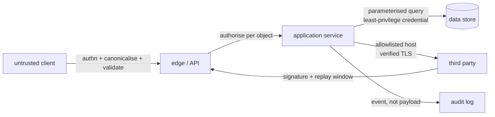

# Code security maxims and contracts

> **The rule, in one line.** Every piece of shippable code that processes data it did not create abides by the twenty-three contracts below. A contract is not a preference, and unlike the rest of engineering, the person deciding whether it held is not the person who wrote it. A maxim can be argued with. A contract can only be met, or explicitly declared unmet before the code ships.

**The security third of one standard.** The [development contracts](development.md) govern how software is built; the [infrastructure contracts](infrastructure.md) govern what it runs on; this one governs what code does when someone is actively trying to make it do something else. Code that crosses a line answers to all three.

Part I holds twenty-eight maxims, Part II twenty-three contracts with what enforces each, Part V five clauses learned the hard way, and Part VI says honestly what a machine decides and what rests on a person remembering.

**Items are citable.** A maxim is `SEC-M12`, a contract `SEC-C7`, a clause `SEC-H3`. Cite them in reviews, commit messages and audits the way `DEV-C12` and `INF-C9` are cited.

## The security philosophy

**A vulnerability is a correctness failure whose input the attacker gets to choose.**

That is the entire difference, and everything below is downstream of it. An ordinary bug is found by the inputs users happen to send. A security bug is found by inputs someone constructed after reading the source.

So the question is never "does this work?" It is:

> **What happens when someone actively wants this to work differently?**

Three consequences, and each one produces a whole section of this document:

1. **The attacker chooses the input.** Every assumption about shape, size, encoding, order and timing is an assumption that will be tested deliberately.
2. **The attacker chooses the path.** Any route to a capability that skips the check is the route they take, and the unglamorous routes are where checks go missing: a JSON status endpoint, an AJAX handler, a queue consumer, a cron job, an export route. See `SEC-H1`.
3. **The attacker is patient.** Code is read years after it is written, and history is read years after it was rewritten. Safe-today becomes exposed the day the repository is published, the prototype becomes production, or the endpoint is opened. See `SEC-H2`.

Security is therefore a property of the design rather than a layer applied to it. A layer can be bypassed; a design cannot be argued with.

## Industry standards

Security decisions are traceable to a recognised reference rather than to instinct. Instinct here is frequently correct and never auditable.

| Concern | Primary reference |
|---|---|
| Web application risk vocabulary | OWASP Top 10 |
| Verifiable application requirements | OWASP ASVS (L2 is the target for anything holding real customer data) |
| API-specific risk | OWASP API Security Top 10 |
| Secure development lifecycle | NIST SSDF (SP 800-218) |
| Weakness taxonomy | CWE / CWE Top 25 |
| Supply chain integrity | SLSA, OpenSSF Scorecard, SBOM (CycloneDX / SPDX) |
| Cryptographic parameters | NIST SP 800-131A, SP 800-63B |
| Host and cloud baselines | CIS Benchmarks, CIS Controls v8.1 |
| Regulated data | FedRAMP, CJIS, HIPAA, SOC 2, PCI DSS |

**Check the edition before citing an identifier.** Category numbers move between releases. Confirm the current edition before quoting `A01` or an ASVS requirement number: a stale identifier is worse than no identifier, because it looks precise.

These frameworks set the floor a design is measured against. They never establish that a design is safe, and a control that exists only because a framework listed it is a control nobody understands.

## Part I: security maxims

Twenty-eight defaults. Each may be departed from with a written reason, and unlike the development maxims, the reason has to survive an adversary reading it.

### SEC-M1. Security is a design property, not a later layer

A control bolted on after the design is a control the design will route around. Decide where the trust boundaries are while the diagram is still cheap to redraw.

### SEC-M2. A vulnerability is a bug with a hostile author

It is not a separate discipline, a separate backlog or a separate severity scale bolted onto the side. It is a defect that arrives through a deliberately constructed input, which is why the ordinary test suite never finds it.

### SEC-M3. Every input is attacker-controlled until parsed

Not merely untrusted: hostile, and shaped by someone who read the code. Including the inputs that do not feel like input:

- HTTP bodies, query strings, path segments, headers, cookies
- File names, file contents, archive members, image metadata
- Database rows written by an earlier request
- Message queue payloads and cron job arguments
- Webhook callbacks and third-party API responses
- Configuration edited through an admin UI
- Anything read back out of a cache

> A value is trusted when **this** code path validated it, in **this** process, on **this** request. Not before.

### SEC-M4. Canonicalise, then validate

A check performed on a value that has not yet reached its final form is not a check.

```text
receive -> decode / normalise / canonicalise -> validate against an allowlist -> use
```

Double encoding, Unicode normalisation, traversal segments, null bytes and alternate separators all exist to make the validation step inspect something other than what the use step will see.

### SEC-M5. Parse, don't validate

Prefer converting untrusted input into a typed, constrained value over inspecting a string and letting it continue on its way as a string.

```text
if looks_like_an_email(s): use(s)        <- the guarantee evaporates immediately
address = EmailAddress.parse(s)          <- the type carries the guarantee onward
```

This is [`DEV-M2`, make invalid states unrepresentable](development.md), pointed at an adversary. Once parsed, downstream code stops re-deriving the guarantee, and therefore stops getting it wrong in one of the fifteen places.

### SEC-M6. Allowlist; a blocklist is a list of what you thought of

A blocklist enumerates known-bad, which is complete until somebody thinks of something new, and thinking of something new is the entire job description.

Applies to character sets, formats, file extensions and MIME types, redirect targets, outbound hosts, deserialisable classes, sortable column names, template paths and callable command names.

### SEC-M7. Never build an instruction out of strings

Injection is one mistake wearing many costumes: SQL, NoSQL, LDAP, OS command, XPath, template, header, log. Every one is data crossing into a position where it is read as instruction.

The defence is structural, never lexical:

```text
parameterised query          not   escaped interpolation
argument array + exec        not   a shell string
bound template variable      not   concatenation
structured logging fields    not   a formatted line
```

Escaping is what you do when the interface offers nothing better. It is a fallback, it belongs at the sink, and it must be the sink's own escaping.

### SEC-M8. Encode for the sink, not for the source

| Sink | Encoding |
|---|---|
| HTML body | HTML entity encoding |
| HTML attribute | attribute encoding, always quoted |
| JavaScript context | JS string encoding, or better, don't put it there |
| URL parameter | percent-encoding |
| CSS value | CSS encoding |
| Shell | do not encode, pass an argument array |
| SQL | do not encode, bind a parameter |

Sanitising once on the way in and hoping it suits every destination is how a value ends up double-encoded in one place and raw in another.

### SEC-M9. Authentication answers who; authorisation answers may

Two questions, two failure modes, and answering the first is no progress at all on the second. A logged-in customer requesting somebody else's order is fully authenticated and entirely unauthorised.

### SEC-M10. Authorise every request, at the object

Server-side, on every request, against the specific object being touched: not the route, not the menu, not the page that linked here.

- **Function-level failure.** The endpoint never asks whether this role may perform this action.
- **Object-level failure.** The endpoint asks whether the caller may view orders and never whether they may view this order. The identifier came from the request.

### SEC-M11. Deny by default

Fields are not exposed unless listed. Actions are not permitted unless granted. Routes are not public unless declared. Serialisers name their outputs rather than dumping an object.

A `switch` whose `default` branch grants access is a vulnerability waiting for the next enum member.

### SEC-M12. Fail closed

When a security decision cannot be made, the answer is no. Token service timing out, policy file missing, signature unverifiable, environment unidentifiable: refuse.

```text
error while deciding -> deny
error while deciding -> allow     <- never
```

Every "allow temporarily while the checker is down" is one documented outage away from being an open door.

### SEC-M13. Client-side controls are user experience

Disabled buttons, hidden fields, client validation, obfuscated JavaScript and app-side checks are conveniences. Anything the client can be persuaded to skip is also enforced where the client cannot reach.

### SEC-M14. Secrets never live in code

Not in source, not in a committed config file, not in an image, not in a build argument, not in a fixture, not as a default parameter value, and not in a comment explaining why it is fine this once.

### SEC-M15. Don't invent cryptography

| Need | Use | Never |
|---|---|---|
| Password storage | Argon2id, scrypt, bcrypt | a fast hash, or encryption |
| Symmetric encryption | AEAD: AES-GCM, ChaCha20-Poly1305 | ECB, unauthenticated CBC |
| Integrity | HMAC, signatures | hash-of-concatenation |
| Key derivation | HKDF, PBKDF2 | a hash of the password |
| Security randomness | the platform CSPRNG | `rand()`, `Math.random()`, a timestamp, a PID |
| Secret comparison | constant-time compare | `==` |

Two rules catch most of the rest: never encrypt where you meant to authenticate, and never reuse a nonce or IV.

### SEC-M16. Unguessable where the identifier is the control

If knowing the URL is what grants access (a reset link, a signed download, a share link, an invitation), the identifier is long, random and CSPRNG-generated. Sequential integers are enumerable, and somebody will enumerate them.

Where a link is a credential it needs a credential's properties: expiry, single use, revocation, and binding to its subject.

### SEC-M17. Errors must not teach the attacker

An error message is an oracle. Helpful to the operator, uninformative to everybody else.

```text
internal:  full context, stack, identifiers, correlation id
external:  "Something went wrong."  +  that same correlation id
```

This is the one place `DEV-C5`, errors preserve context, is deliberately split rather than contradicted: all the context stays inside, none of it goes out. A distinguishable "no such user" and "wrong password" turns a login form into an account enumerator, and response timing is part of the message, so a check that returns faster when the account does not exist has said so out loud.

### SEC-M18. Log the event, never the payload

Security logging fails in both directions and both are defects.

**Too little.** No record of who authenticated, who was refused, what changed, from where. Nothing can be reconstructed afterwards.

**Too much.** Passwords, tokens, session identifiers, card numbers and personal data written into a file with weaker access control than the database they were protecting. Log the actor and the action, not the body.

### SEC-M19. Every dependency is executing code

A dependency runs with the full privilege of the process. `DEV-M9`, dependencies are debt, applies, plus: is it maintained and by how many people, what does it depend on, does it execute code at install time, is the name plausibly typosquatted, and would we find out if it changed?

### SEC-M20. Time of check is not time of use

A permission verified, a file inspected, a balance read, a token validated: each is a fact about a moment that has already passed. Where the gap matters, close it with atomic operations, transactions at the right isolation, conditional updates, locks, idempotency keys and single-use tokens.

Concurrency bugs become security bugs the moment money, quota, entitlement or uniqueness is involved.

### SEC-M21. Resource limits are a security control

Availability is a security property, and code gives it away cheaply. Bound everything an attacker can grow: body and upload size, page and batch size, recursion and nesting depth, decompressed size and archive member count, query and HTTP timeouts, retry counts, regular-expression complexity on untrusted input, and concurrent work per caller.

An unbounded loop over attacker-supplied input is a denial-of-service primitive with a friendly name.

### SEC-M22. Tenancy is an invariant, not a filter

In any system with more than one customer, user, store or website, the scoping predicate is not an optional clause somebody remembers. Enforce it structurally: a repository layer that cannot build an unscoped query, a scope derived from the session and never accepted from the request, row-level policies where the database offers them.

The dangerous version is the one that works: correctly scoped in fourteen places, inherited unscoped in the fifteenth.

### SEC-M23. Data carries its classification everywhere it goes

Know which values are credentials, which are personal, which are regulated and which are public. The classification determines encryption, retention, masking, logging, export, backup and who may read the copy that landed in a lower environment.

Production data in a development environment is still production data. See `SEC-H5`.

### SEC-M24. Deletion is a control

Data that no longer exists cannot be stolen, subpoenaed or leaked. For every class of sensitive data, know how long it is kept, what deletes it, and whether deletion reaches backups, caches, search indexes, logs, analytics and third-party processors.

### SEC-M25. Dead code is live attack surface

An unused endpoint is still routed. A disabled feature still has a code path. A debug route still answers. A superseded module still autoloads. `DEV-M15`, delete before you abstract, pays a security dividend.

### SEC-M26. Patch velocity is a control

The gap between a public advisory and a deployed fix is a window somebody is actively scanning for. A system needs a known answer to how an advisory reaches us, how we decide whether it applies, how fast a fix ships, and what we do while there is no fix.

"Eventually" is not a patch strategy.

### SEC-M27. Assume breach

Design as though one component is already compromised. Would a leaked read-only database credential expose plaintext secrets? Would a compromised front-end container reach the payment service? Would a stolen session token still work tomorrow, from another continent? Would anybody notice?

Segment, scope, expire and record.

### SEC-M28. Security must be measurable

```text
"the application should be secure"            <- unverifiable
"no endpoint returns data without a session"  <- testable
a test that fails the build                   <- enforced
```

`DEV-M18`, automation is documentation, with sharper teeth: a security rule that lives only in someone's head is a rule that expires the day they are on holiday.

## Part II: security contracts

Twenty-three requirements. Each says what decides it, and where nothing mechanical decides it, that is said plainly rather than implied. See Part VI for the honest picture.

### SEC-C1. Every entry point has an identified caller and an explicit decision

For every route, handler, console command, consumer, job and callback, two questions have answers in code: who is calling, and are they permitted to do this to this object?

An entry point that answers neither is public. Treat it as public or fix it.

**Enforced by** review, plus the session-less probe in `SEC-H1`. No static check can tell an intentionally public route from a forgotten one.

### SEC-C2. Every query is parameterised

No untrusted value is concatenated into SQL, a NoSQL filter document, an LDAP filter, an XPath expression or a raw ORM fragment. Where the structure is dynamic (sort column, direction, table), the value resolves through an allowlist map rather than interpolating.

**Enforced by** a static analyser and linter rules for several shapes, where the stack has them; the ORM and collection layer covers most of the rest by construction. Raw fragments are review-only.

### SEC-C3. Every output is encoded for its sink

Templates escape by default. Disabling escaping is a reviewed, justified, commented exception. Anything building markup, headers, redirects, CSV rows or filenames from untrusted data encodes for that destination, including the formula-injection prefixes in an exported spreadsheet.

**Enforced by** a template-escaping rule in a linter or static analyser, where the stack has one, run at a severity that fails the build. Elsewhere, review.

### SEC-C4. Every upload is hostile content

Validated on content rather than on the filename or the client's declared type, and:

- Size limited before being read into memory
- Stored outside any directory the web server will execute or serve directly
- Renamed to a generated identifier
- Served through a handler that sets `Content-Type` and `Content-Disposition` deliberately
- Scanned where the environment requires it

Archives get member count, member size, total expanded size and traversal checks before extraction.

**Enforced by** review, plus pattern rules for the shapes a project has met. Hostile content is larger than any set of shapes.

### SEC-C5. Every outbound URL is allowlisted

Any URL the server fetches, redirects to, renders or embeds because untrusted input said so is checked against an allowlist of hosts and schemes, and re-checked after every redirect.

Guard specifically against loopback and private ranges, link-local metadata addresses, DNS names that resolve inward, and non-HTTP schemes. Open redirect and SSRF are the same missing allowlist in two places.

**Enforced by** review, and pattern rules where a static analyser has them. Vendor integrations that fetch URLs and media pipelines are where this usually lands.

### SEC-C6. Deserialisation is typed and bounded

Never deserialise an untrusted byte stream into arbitrary objects. Prefer data formats over object formats, bind into declared types, cap depth and size, and allowlist any class a format may instantiate. If a payload must be trusted, sign it and verify before parsing.

**Enforced by** a linter rule that flags the classic offenders, where the stack has one. Everything else is review.

### SEC-C7. Every credential is externalised, scoped and rotatable

A credential comes from the environment or a secret manager, holds the narrowest privilege that works, and rotates without a code change. Each one has a known answer to: who can read it, what it can do, when it expires, and what breaks when it rotates.

**Enforced by** a secret scanner for the presence of a credential in a repository. Scope and rotatability are review-only.

### SEC-C8. No secret reaches a commit; a secret that does is rotated

Two clauses, and the second is the one that gets skipped:

1. A pre-commit check scans the change before it becomes history.
2. A credential that reached a commit is rotated, not merely removed. Removal edits the future; the key was already published to every clone.

Before a repository is first published, its history is swept, not its working tree.

**Enforced by** a secret scanner with a working-tree mode and a full-history mode, installed as a pre-commit hook.

### SEC-C9. Passwords are hashed with a memory-hard KDF

Per-user salt, current parameters, and a documented rehash-on-login path so the parameters can be raised later. Never encrypt a password: reversibility is the whole objection. Never use a fast hash, and never truncate before hashing.

**Enforced by** review, plus the framework's own password hashing where one exists. Rolling your own is the failure this catches, and it is caught by reading.

### SEC-C10. Sessions have a full lifecycle

CSPRNG-generated identifier; rotated on login and on any privilege change; idle timeout and absolute timeout; revocable server-side, individually and in bulk; cookies marked `HttpOnly`, `Secure` and the strictest `SameSite` the flow allows; logout invalidating server-side rather than only in the browser.

A token that cannot be revoked is a permanent credential, whatever its expiry claim says.

**Enforced by** review and framework configuration.

### SEC-C11. Transport is encrypted and verified

TLS everywhere, including service-to-service calls inside a trusted network.

> **Certificate verification is never disabled.** Not for a test, not for a prototype, not behind a flag, not temporarily. That line outlives the reason it was written, and it never announces itself afterwards.

**Enforced by** review and pattern rules for disabled verification. Local development uses real certificates from a local certificate authority (for example `mkcert`) precisely so nobody needs a verification-off switch to get work done.

### SEC-C12. Internal and administrative surfaces are not exempt

Admin panels, internal APIs, debug tooling, metrics endpoints, queue dashboards and status pages authenticate and authorise exactly like everything else.

> **Network position is not authentication.** "It is only reachable inside the private network" is a second layer, never the first. See `INF-M8`, identity before network.

**Enforced by** the session-less probe in `SEC-H1`, by hand or scripted, plus a pattern check where a stack allows one (for example, one that refuses an admin controller that does not extend the base class carrying the login check). A pattern check decides a shape in a file; only a request against the running application settles it.

### SEC-C13. Dependencies are pinned, locked and monitored

Lockfiles committed, production builds resolving to exact versions, images referenced by digest where practical, and the dependency tree scanned for known vulnerabilities on a cadence, with findings triaged rather than accumulated. Internal package names must not be resolvable from a public registry.

**Enforced by** lockfiles and the package manager's own validity check, a known-vulnerability scan of every locked dependency that fails the build above a chosen severity, and a check that each pinned CI action is a real commit. Container images and SBOM generation need their own scan; a project without one has not met this contract in full, and says so.

### SEC-C14. Every dangerous construct carries a justification

Not forbidden, but never casual:

```text
eval / dynamic code execution
shell invocation built from a string
native deserialisation of external data
dynamic include or require from a variable
reflection driven by request data
disabled TLS verification
disabled template escaping
raw SQL fragments
wildcard CORS with credentials
```

Each occurrence carries a comment naming why it is safe here, and each is a review trigger.

**Enforced by** linter and static-analysis rules for a subset, where the stack has them, and a pre-commit check that refuses debugging leftovers such as `die(`, `var_dump(` and `console.log(`. The rest is review.

### SEC-C15. Every security control has a test

A control without a test is a control a future refactor removes and every reviewer misses.

Test the negative case explicitly: the unauthenticated request is refused, the other tenant's object is not returned, the oversized upload is rejected, the invalid signature does not verify. A test that only proves the happy path proves the feature, not the control.

**Enforced by** review. A check that a test file exists proves nothing about whether it tests the refusal. This is `DEV-C10`'s gap at its most expensive.

### SEC-C16. Every vulnerability produces a regression test and a class sweep

Fixing the reported instance is half the work.

1. Write the test that fails before the fix.
2. Name the class of defect.
3. Search the codebase for the rest of the class.
4. Fix them, or record why they are not affected.
5. Prevent recurrence mechanically where possible.

One IDOR is a finding. One IDOR fixed alone is a finding wearing a better disguise.

**Enforced by** review, and the search you actually run. The sweep has to reach outside the repository being edited, into vendored and shared packages, the same way `DEV-C16`'s consumer discovery does.

### SEC-C17. Every inbound callback is verified

Webhooks, payment notifications, SSO assertions and third-party callbacks are attacker-reachable endpoints arriving dressed as trusted traffic. Verify the signature against the raw body, enforce a timestamp window, reject replays by identifier, and confirm the event against the source of truth before acting on money or entitlement.

**Enforced by** review, and pattern rules where a project has written them.

### SEC-C18. Abuse-prone actions are rate limited server-side

Login, password reset, registration, token exchange, search, export, messaging, coupon redemption, and anything expensive. Limit per account, per address and per target, and make the limits observable: a rate limiter nobody can see is a rate limiter nobody notices failing.

**Enforced by** review and edge configuration.

### SEC-C19. Security-relevant events are audited

Authentication success and failure, authorisation denial, privilege change, credential change, configuration change, data export, administrative action. Each record carries actor, action, target, source, timestamp and outcome; records are append-only in intent, retained deliberately, and protected at least as well as the data they describe.

**Enforced by** review. See `INF-M15` for where the records live.

### SEC-C20. Personal data is minimised, masked and retained deliberately

Collect what is needed, keep it as long as it is needed, mask it wherever it is displayed or exported, and know every system it has been copied into. The inverse of a logging failure is logging too much: a PII leak through a log file is a data breach with a stack trace attached.

**Enforced by** review, plus whatever the applicable regime demands.

### SEC-C21. Security-sensitive changes get a security review

Any diff touching authentication, authorisation, session handling, cryptography, secrets, deserialisation, file handling, outbound requests, payments, personal data or dependency versions is reviewed with that lens named.

The reviewer's question is not "is this correct?" but **"what would I try against this?"**

**Enforced by** review, deliberately. This is the contract that makes the other twenty-two get read.

### SEC-C22. Every exception is time-bound and owned

Where a contract cannot be met, the exception is written down:

```text
what is not met
why
what compensates for it
who owns it
when it expires
```

An exception without an expiry is a silent policy change.

**Enforced by** review, and by whoever reads the expiry date.

### SEC-C23. There is a route to report a vulnerability, and a route to respond

A contact path, an owner, a triage process, a severity scale, a disclosure position, and a record of what was decided. A finding with nowhere to go becomes a finding that goes somewhere else.

**Enforced by** organisational process, not code.

## Part III: threat modelling in practice

No ceremony required. Four questions, asked while the design is still cheap to change:

1. **What are we building?**
2. **What can go wrong?**
3. **What are we going to do about it?**
4. **Did we do a good job?**

STRIDE is the usual prompt for question 2:

| Threat | The question | Typical control |
|---|---|---|
| **S**poofing | Can someone pretend to be another identity? | Authentication, signatures, MFA |
| **T**ampering | Can data or code be modified in flight or at rest? | Integrity checks, AEAD, access control |
| **R**epudiation | Can an actor deny what they did? | Audit logging, attribution |
| **I**nformation disclosure | Can data reach someone unauthorised? | Encryption, authorisation, minimisation |
| **D**enial of service | Can availability be consumed? | Limits, quotas, timeouts, isolation |
| **E**levation of privilege | Can someone gain capability they were not granted? | Least privilege, deny by default, validation |

The artifact that makes question 2 answerable is a data flow with its trust boundaries drawn on it. Every boundary crossing is a place a control belongs.



A diagram with no boundaries on it is an architecture diagram, not a threat model. The boundaries are the entire point: they are where the contracts in Part II attach to something real.

## Part IV: vulnerability classes and the defence that holds

One table, because a category name only becomes useful when it maps to a change someone can make.

| Class | Root cause in code | Defence that actually holds |
|---|---|---|
| Broken access control | The decision is missing, or made on request-supplied identity | Server-side check per request, per object; deny by default |
| Injection | Data reaching an instruction position | Parameterisation, argument arrays, structural binding |
| Cross-site scripting | Untrusted value rendered without sink-appropriate encoding | Escaping by default, contextual encoding, CSP as depth |
| Cryptographic failure | Home-made scheme, wrong primitive, plaintext at rest | Vetted AEAD, memory-hard KDFs, TLS everywhere |
| Insecure design | The flaw is the rule, not the code | Threat model; enforce business invariants server-side |
| Security misconfiguration | Defaults left on, surfaces left open | Hardened defaults, configuration scanned in CI |
| Vulnerable components | Unpinned, unmonitored dependencies | Lockfiles, digests, scanning, patch cadence |
| Identification failure | Weak sessions, enumerable accounts, no lockout | Session lifecycle, uniform errors, rate limits |
| Integrity failure | Unverified update, unsigned payload, unverified callback | Signatures, digests, provenance |
| Logging failure | No record, or a record of the wrong thing | Audit events without sensitive payloads |
| SSRF | Server fetching an attacker-chosen URL | Host and scheme allowlist, re-checked after redirects |
| Deserialisation | A byte stream becoming arbitrary objects | Typed binding, class allowlists, signed payloads |
| Race condition | Check and use separated in time | Atomic operations, transactions, idempotency keys |
| Resource exhaustion | Unbounded work on untrusted input | Limits on every dimension |
| Secret exposure | Credential in source, image, log or history | Externalised secrets, history scanning, rotation |

## Part V: clauses learned in practice

Five clauses, each of which exists because of something specific that went wrong. Where an example names a platform, it is one example of a general rule.

### SEC-H1. An admin URL that answers without a session is a defect

Every admin URL requires login. Anonymous access of any kind in the admin area is unacceptable, including read-only JSON endpoints, AJAX handlers, status pollers and health checks.

The trap is that the insecure version reads as fine in source. For example, in a PHP web application, an admin controller implementing only the plain HTTP-method interface is not protected: the login check and the permission-resource check both live in the base action's dispatch method, so a plain-interface controller never runs them and its declared permission resource is decorative. The platform's secret-key validator only checks the key once you are already logged in, so a bogus key on a session-less request proves nothing.

- Admin controllers extend the base class that carries the login and permission checks, keep a real permission resource, and implement the matching method interface.
- Never switch off CSRF protection or the secret-key requirement to make AJAX work. Fix the caller instead.
- **Verify by calling it with no session.** Reviewing the code is not verification.

```bash
curl -sS 'https://app.example.test/admin/<route>/?isAjax=true'
```

Expect the login page or a session-expired body, never payload data. Some admin areas signal an auth failure with HTTP 200 and an error body rather than a 4xx, so a status-code assertion is not a test of this.

A JSON status endpoint returning HTTP 200 with live data to a session-less request passed every automated check in its repository.

### SEC-H2. The working tree is not the repository

A key removed in a later commit is still in the object store, still in every clone, and still there on the day the repository is published. Publishability is a property of history.

Scan the full history before any first push and after any rewrite; a key that reached a commit is rotated, not deleted. A repository one commit from publication had a spotless working tree and a first commit holding ten environment-variable fallbacks with real values in them.

### SEC-H3. A green gate proves nothing about the assembled application

The security failures that actually occur often pass every automated check. For example, in a PHP web application:

- A permission tree whose parent chain skipped a node created a second node rather than re-parenting one, which made building the access-control list throw, failing every admin authorisation check and putting the whole admin into a redirect loop. An authorisation failure is a redirect rather than an exception, so the exception log stayed completely silent.
- An area-scoped configuration file declaring an array argument replaced the global array wholesale, silently removing every other module's registration.
- A stale dependency-injection container left a new plugin inert while its unit tests passed, so a change that looked deployed had never run.

The rule that follows: after editing an access-control definition, clear the configuration cache, bootstrap the application, walk the merged resource list for duplicate ids and call the builder to prove it does not throw. When a change touches dependency wiring, access control, message-queue topics or interceptors, verify against the running application, or say plainly that you could not.

### SEC-H4. A third-party defect is patched, and a vendor fix is not shipped until it is released

A defect in third-party code gets a registered, locked patch with the patched file verified afterwards. Not a subclass override: that re-declares the parent's private methods and drifts silently on every upgrade, which is a security fix that stops applying without telling anybody.

A change to a vendored package is made in that package's own repository, because the vendor directory is ignored by version control, so the edit is invisible to the application's branch and reverted by the next install. It is not done until it is committed to the package repository, released through the package feed and pulled back. A silently reverted security fix is worse than one never made, because the ticket is closed.

### SEC-H5. Production-derived data does not become harmless by being local

`SEC-M23` in its local form. A local copy of the stack, a health-check extract and every reconciliation CSV dump carry real data. Extracts that are ignored by version control have no version history and no remote copy anywhere.

That cuts both ways and both matter: they are unprotected by the repository's own history, and they are unnoticed by anything that sweeps the repository for sensitive content. Treat an extract as classified by its source, not by its location.

## Part VI: enforcement, honestly

A contract is enforced at one of three levels, and the report says which:

- **Mechanically enforced.** A command fails and the work stops.
- **Partially enforced.** A gate exists but its coverage is incomplete, or it is installed in some places and not others.
- **Review-only.** No mechanical check exists. The contract still binds; only its enforcement is human.

Nothing here pretends a machine is watching where one is not. What a rule decides is a pattern in a file, and a contract is larger than any pattern. `SEC-C12` is only truly settled by a session-less request against a running application, and a static rule that finds admin controllers without a login check is the argument for saying so.

Where a stack has no gate for a contract, expect most of these to rest on review: `SEC-C9` password hashing, `SEC-C10` session lifecycle, `SEC-C16` regression sweep, `SEC-C18` rate limiting, `SEC-C19` audit logging, `SEC-C20` data minimisation, `SEC-C21` security review (review-only by design), `SEC-C22` expiring exceptions and `SEC-C23` a route to report.

## Part VII: the security quality gate

Security that depends on remembering degrades under deadline. The stages before review are machine work; the ones after are judgment.

1. Secret scan, tree and history.
2. Static analysis (SAST).
3. Dependency and licence scan.
4. Security tests, the negative cases.
5. Container and infrastructure-as-code scanning.
6. Review, with the security lens named.
7. Dynamic testing where applicable.
8. Deployment.
9. Runtime detection and audit.
10. Advisory monitoring, then patch.

Two properties matter more than coverage. **Findings must be triaged rather than accumulated**, and **the gate must fail the build**. A scanner whose output nobody reads costs time and buys nothing, and worse, it buys the appearance of a control, which is how `SEC-C22`'s missing expiry date becomes a permanent one.

## Part VIII: the security constitution

> **Code authenticates every caller, authorises every action, distrusts every input, encodes every output, protects every secret, bounds every resource, records every decision that matters, and fails closed when it cannot decide.**

Secure code treats every input as attacker-chosen; validates after canonicalisation against an allowlist; converts untrusted input into constrained types; never constructs an instruction by concatenation; encodes for the destination at the destination; separates authentication from authorisation and performs both on the server, per request, per object; denies by default and fails closed; keeps secrets out of source, images, logs and history; uses vetted cryptography rather than invented cryptography; reveals nothing useful in an error and everything useful internally; logs the event rather than the payload; bounds size, depth, time and concurrency; treats every dependency as executing code; deletes what is no longer used; tests the refusal rather than the happy path; fixes the class rather than the instance; and makes every exception time-bound and owned.

## Part IX: the short version

Forty lines.

1. A vulnerability is a bug whose input the attacker chooses.
2. Security is a design property, not a later layer.
3. Every input is hostile until parsed.
4. Canonicalise, then validate.
5. Allowlist; never blocklist.
6. Parse, don't validate.
7. Never concatenate an instruction.
8. Encode for the sink.
9. Authentication is not authorisation.
10. Authorise every request, at the object.
11. Deny by default.
12. Fail closed.
13. Client-side controls are not controls.
14. Internal and admin surfaces are not exempt.
15. Network position is not authentication.
16. Secrets never live in code.
17. History, not the working tree, is what publishes a key.
18. A leaked credential is rotated, not deleted.
19. Don't invent cryptography.
20. Passwords get a memory-hard KDF.
21. Security randomness comes from a CSPRNG.
22. Unguessable identifiers where the URL is the control.
23. Errors help the operator and teach the attacker nothing.
24. Log the event, not the payload.
25. Every dependency is executing code.
26. Pin, lock and monitor everything you depend on.
27. Time of check is not time of use.
28. Limits are a security control.
29. Tenancy is an invariant, not a filter.
30. Data carries its classification everywhere it goes.
31. Production data stays production data in a lower environment.
32. Deletion is a control.
33. Dead code is live attack surface.
34. Verify every inbound callback.
35. Rate limit what can be abused.
36. Audit what matters, and protect the audit.
37. Test the refusal, not the happy path.
38. Fix the class, not the instance.
39. Every exception expires.
40. Assume breach, and design so somebody notices.

## The five laws

> **The adversary law.** Assume the attacker has read the source, holds a valid account, controls the client, and has more patience than the release schedule.

> **The boundary law.** Every place data changes hands is a place a control belongs; a boundary with no control is a boundary in name only.

> **The secret law.** A secret written anywhere it can be read twice is already compromised, and the only remedy is rotation.

> **The privilege law.** Grant the narrowest capability that makes the code work, then assume that capability will one day be exercised by somebody else.

> **The evidence law.** If we cannot demonstrate that a control exists, functions and is tested, we do not have a control, we have an intention.

## Framework alignment

| Concern | Primary reference |
|---|---|
| Application risk categories | OWASP Top 10 |
| Verifiable requirements | OWASP ASVS (L2 for anything holding customer data) |
| API-specific risk | OWASP API Security Top 10 |
| Secure development lifecycle | NIST SSDF (SP 800-218) |
| Weakness taxonomy | CWE / CWE Top 25 |
| Threat modelling | STRIDE; LINDDUN where privacy is the concern |
| Programme maturity | OWASP SAMM, BSIMM |
| Supply chain integrity | SLSA, OpenSSF Scorecard, SBOM |
| Cryptographic parameters | NIST SP 800-131A, SP 800-63B |
| Logging and detection | NIST CSF 2.0 (Detect), CIS Control 8 |
| Vulnerability management | CIS Control 7; CVSS and EPSS for prioritisation |
| Payment data | PCI DSS |
| Personal data | GDPR, CCPA and applicable regional law |

These frameworks are reference standards, not substitutes for applicable legal, regulatory, contractual or organisational requirements. Where a formal compliance regime applies, its requirements take precedence, and where none applies, the absence of a regime is not the absence of a duty.
